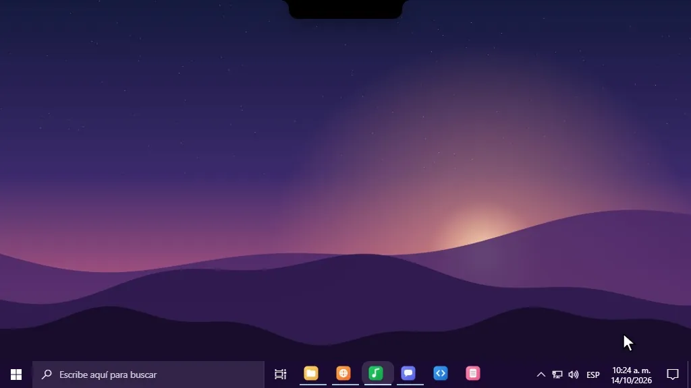

<div align="center">



<br>

<a href="https://github.com/Tkyoxx/Cocuyo/releases/latest"></a>


<br>

<a href="README.md">Español</a> · <a href="CHANGELOG.md">What changed</a> · <a href="CONTRIBUTING.md">Help out</a>

</div>

# Cocuyo

A black island at the top of your screen that listens. Talk to it and it plays music, opens apps, reminds you of things, types for you or tells you what's eating your PC's RAM. Your voice is understood **on your PC**: no account, no subscription, nothing sent to anyone.

It's made in Colombia and speaks Spanish first, but the whole app, the answers and the commands also work in English and Portuguese (Settings → Voice → Language).

## What it does

- Dictate in any app and it gets typed, with punctuation. Two taps on the keys for hands-free, your own words always spelled right and text shortcuts.
- Give it orders however they come out: "play some salsa", "open Discord", "remind me in 20 minutes to take the laundry out".
- Live conversation with Gemini: it listens while you talk and answers out loud right away, and uses its tools in the meantime.
- Drop a file on the island and ask what it's about: PDF, Word, Excel, PowerPoint, images or text, with follow-up questions right there.
- WhatsApp without opening WhatsApp: new messages arrive in a floating bubble you can reply from, it reads them to you and you reply by voice, always asking before it sends.
- Circle something on screen with the mouse and ask what it is.
- Spotify, Discord, volume, weather, tasks, reminders and routines, all from the same island.
- A screen recorder with instant replay that's lighter than OBS, live wallpapers and a taskbar your way.
- Scripts by voice, extensions and a gallery where people share theirs.
- It updates itself, and if you plug in an AI model (Gemini has a free plan, or use your own Claude subscription), it understands even better.

## Things to try

| Do this | It does that |
|---|---|
| Hold `Ctrl` + `Win` and talk | Types what you said where your cursor is |
| Tap `Ctrl` + `Win` twice | Hands-free dictation: tap again to paste, `Esc` cancels |
| Hold `Alt` + `Win` and say "play something" | Something random from your playlists |
| Hold `Ctrl` + `Shift` and circle something | Saves it, and with an AI model, tells you what it is |
| Drop a file on the island | Get its text, ask about it, open it |
| Click the island, then the pencil | Type an order or a question |
| Say "how much quota do I have left?" | Answers without any AI |

## Install

Open `Cocuyo.exe`. The first time, the island offers to install itself for your user only, with no admin rights. Windows may say "Windows protected your PC" because the app isn't signed yet: click **More info → Run anyway**.

The first time it walks you through five steps. Then, in **Settings → Voice → Local voice**, click **Download** (424 MB, once) and you're ready.

## Privacy

No accounts and nothing of yours is collected. Without AI, your voice and captures never leave your PC. With AI, what you say goes to the provider you picked, and Settings → AI always tells you exactly what leaves. The full list is in the [Spanish README](README.md#privacidad).

## Build

```
npm install
npm run tauri dev
```

Rust in `src-tauri/`, the island in plain TypeScript in `src/`. Tests: `cd src-tauri && cargo test` and `npm test`.

## License

MIT for the code. The name "Cocuyo" and its icon are kept for this project: see [MARCA.md](MARCA.md).
