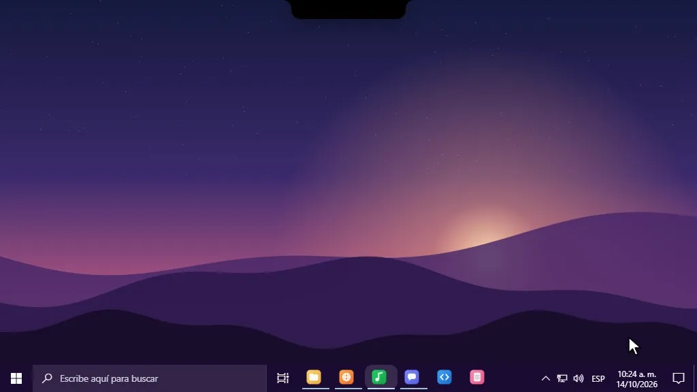
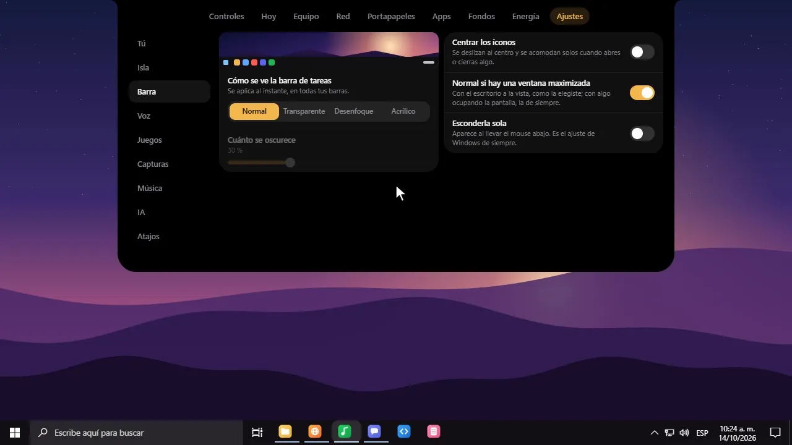
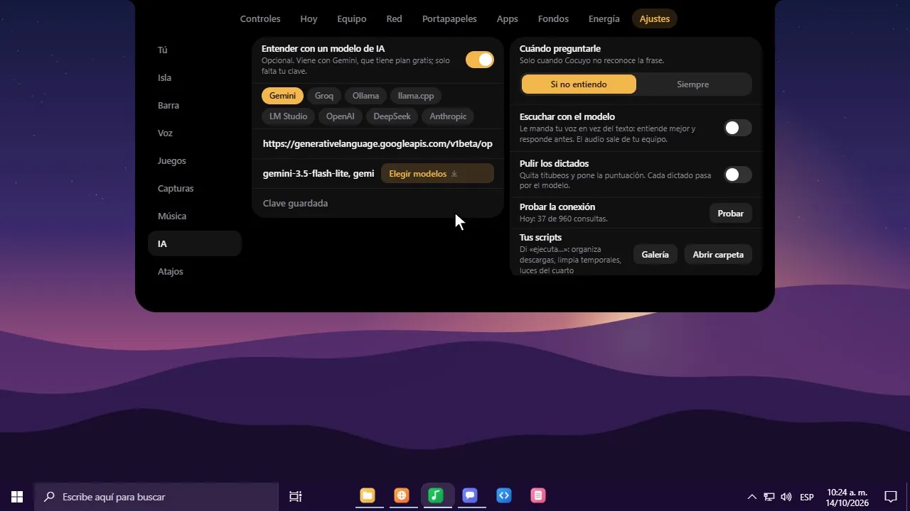
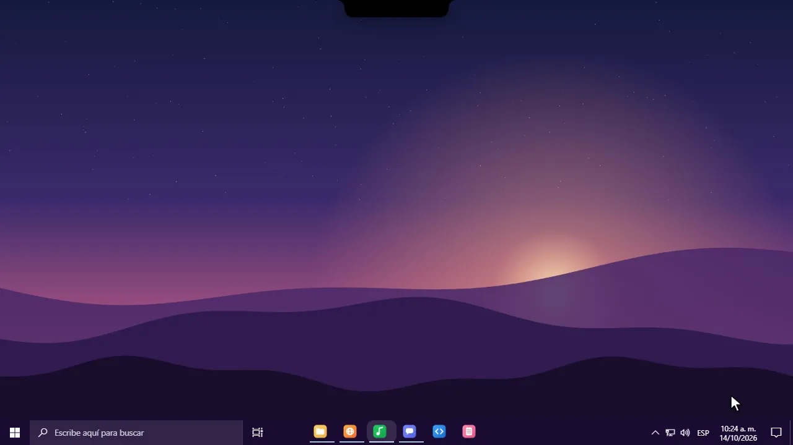
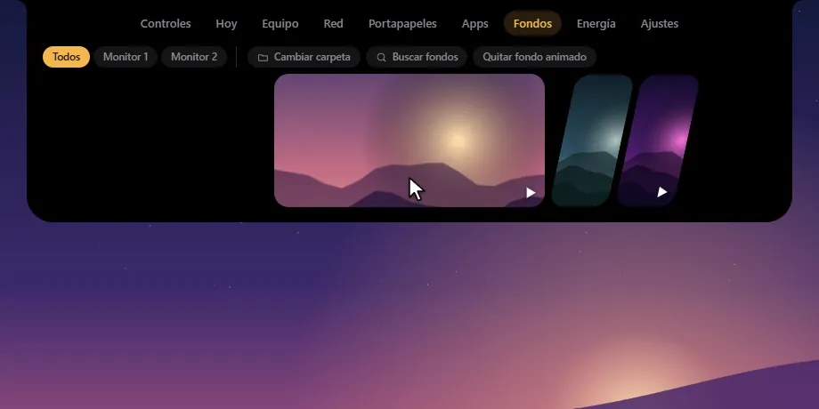
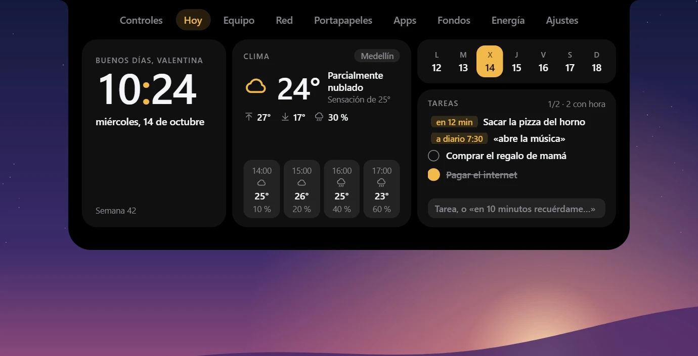
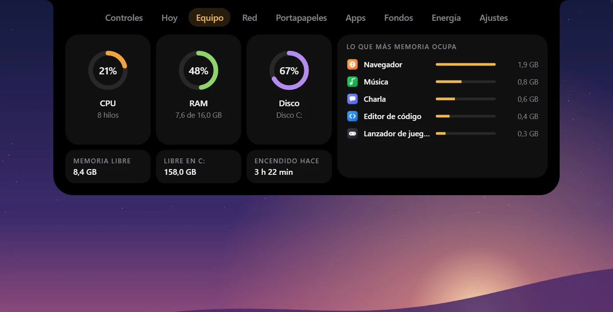
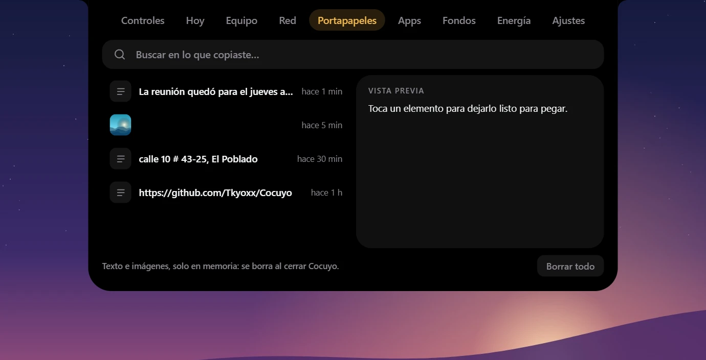

<div align="center">



<br>

<a href="https://github.com/Tkyoxx/Cocuyo/releases/latest"></a>


<br><br>

Una isla negra arriba de tu pantalla que te escucha. Le hablas y pone música, abre apps,<br>
te recuerda cosas, escribe por ti o te cuenta qué le está comiendo la RAM a tu PC.<br>
La voz se entiende <b>en tu equipo</b>: sin cuenta, sin suscripción y sin mandar nada a nadie.

<br>


</div>


## Lo que hace

- Dictas en cualquier app y queda escrito, con la puntuación puesta.
- Le das órdenes como te salgan: «pon algo de salsa», «ábreme Discord», «recuérdame en 20 minutos sacar la ropa».
- Conversación en vivo con Gemini: te va escuchando mientras hablas y contesta con voz al instante (Charon, Puck, Kore…), y mientras tanto usa sus herramientas. Si le preguntas «¿qué hago aquí?», mira tu pantalla; si lo interrumpes, se calla y te escucha.
- Aprende de lo que hablan: después de una charla guarda solo lo que vale la pena recordar (quién es tu hermano, en qué andas) y lo usa la próxima vez.
- Toma apuntes de clases, reuniones y llamadas: «toma apuntes», y escucha lo que suena en el PC y tu micrófono; al decir «termina los apuntes» te deja el resumen, los puntos clave y los pendientes.
- Rodeas algo de la pantalla con el mouse y le preguntas qué es.
- Spotify, volumen, clima, tareas, agenda y rutinas, todo desde la misma isla.
- Fondos animados que no se comen el PC, uno distinto por monitor.
- La barra de tareas a tu gusto: transparente, acrílico o centrada, también en Windows 11.
- Scripts por voz y una galería donde la gente comparte los suyos.
- Modo agente: decide solo si algo es una orden rápida o una tarea con pasos, y la hace con sus herramientas, servidores MCP o el mouse y el teclado.
- Se actualiza sola, y si tienes un modelo de IA (Gemini tiene plan gratis), entiende todavía mejor.

<br>

<table>
  <tr>
    <td width="50%" valign="top">
      
      <h3>Tu barra, como la quieras</h3>
      Transparente, desenfoque o acrílico, cuánto se oscurece y los íconos al centro, con su animación. Sin instalar nada más.
    </td>
    <td width="50%" valign="top">
      
      <h3>Una galería de scripts</h3>
      Como un workshop: cada script con el nombre y la foto de quien lo subió. Los instalas con un clic y los usas por voz.
    </td>
  </tr>
  <tr>
    <td colspan="2" valign="top">
      
      <h3>Hazle lo que quieras</h3>
      Scripts que responden con tarjetas, barras de progreso y preguntas; temas que le cambian la cara a la isla; extensiones que le añaden pestañas, efectos y órdenes de voz. Como Spicetify, pero para tu escritorio. Todo en <a href="sdk/README.md"><code>sdk/</code></a>.
    </td>
  </tr>
  <tr>
    <td width="50%" valign="top">
      
      <h3>Fondos animados</h3>
      Videos detrás de los íconos, decodificados por la gráfica. Se pausan solos cuando no se ven y cada monitor puede tener el suyo.
    </td>
    <td width="50%" valign="top">
      
      <h3>Tu día de un vistazo</h3>
      La hora, el clima de tu ciudad por horas, tus tareas y lo que le pediste recordar.
    </td>
  </tr>
  <tr>
    <td width="50%" valign="top">
      
      <h3>Qué le pasa a tu PC</h3>
      Procesador, memoria, disco y qué programa se está comiendo la RAM. También por voz: «¿qué me pone lento?».
    </td>
    <td width="50%" valign="top">
      
      <h3>Lo que copiaste</h3>
      El historial del portapapeles, con imágenes. De una captura puedes sacar el texto y dejarlo copiado.
    </td>
  </tr>
</table>

<p align="center"><sub>Las imágenes son de la app real, grabadas con datos inventados (nombres, canciones y apps de ejemplo). Se regeneran con <code>vitrina/grabar.mjs</code>.</sub></p>


> **Estado:** en construcción, pero ya se usa. Si algo te falla, [cuéntamelo en un issue](https://github.com/Tkyoxx/Cocuyo/issues).

## Atajos

| Atajo | Para |
|---|---|
| Mantener `Ctrl` + `Win` y hablar | Dictar donde tengas el cursor |
| Mantener `Alt` + `Win` y hablar | Darle una orden |
| Mantener `Ctrl` + `Shift` y mover el mouse | Rodear una zona y capturarla. Con un modelo de IA conectado, habla mientras rodeas y te responde sobre lo rodeado |
| `Impr Pant` | Capturar un rectángulo arrastrando |
| `Alt` + `Impr Pant` | Capturar la ventana activa |
| `Ctrl` + `Impr Pant` | Capturar toda la pantalla |

Todos se cambian en la pestaña **Ajustes** del menú. Si otra app ya usa `Impr Pant` (Greenshot, por ejemplo), Windows no se lo cede a Cocuyo: ciérrala y reinicia Cocuyo, o elige otro atajo.

## Órdenes que entiende

No hay frases que aprenderse: dilo como te salga. Estos son ejemplos, no la lista.

| Dices | Hace |
|---|---|
| «pon De Música Ligera», «quiero escuchar a Héctor Lavoe», «ponme la de Bad Bunny que dice Tití me preguntó» | Suena en Spotify: la canción, o toda la música del artista si nombraste un artista |
| «pon rock en español», «música para dormir», «pon algo suave» | Una lista de ese género o ambiente |
| «pon mi lista de entrenar» | Tu lista con ese nombre |
| «pon algo», «sorpréndeme», «una canción cualquiera» | Algo al azar de una de tus listas |
| «pausa», «para la música», «quita eso» · «sigue», «dale play» | Pausa · continúa |
| «siguiente», «pásala», «la que sigue», «otra» · «la anterior», «devuélvela» · «otra vez», «repítela» | Siguiente · anterior · la misma desde el principio |
| «súbele», «más duro», «bájale un poquito», «volumen al 40», «está muy duro», «no se escucha» | Volumen **de Spotify** |
| «silencia», «cállate» · «quita el silencio» | Silencia Spotify · le devuelve el sonido |
| «sube el volumen de la PC», «volumen del equipo al 50» | Volumen de todo el equipo |
| «abre el bloc de notas», «ábreme Discord y Spotify», «entra a WhatsApp» | Abre la app, o la web si es YouTube, Gmail, WhatsApp… |
| «busca recetas en YouTube», «quiero ver videos de gatos» | Busca en YouTube |
| «busca el clima de mañana» | Busca en Google |
| «busca Hollow Knight en Steam» | Los primeros juegos con su precio en tu moneda, y botones para verlo o jugarlo si ya lo tienes |
| «busca cómo cambiar la pasta térmica en internet» | Una tarjeta con los primeros resultados |
| «busca Simón Bolívar en Wikipedia», «busca restaurantes en mapas», «busca un mouse en Amazon» | Abre la búsqueda en esa página (también GitHub, Twitch, Reddit, Epic, GOG, imágenes, noticias, TikTok y Mercado Libre) |
| «investiga a fondo si vale la pena cambiar mi RX 580» | Una investigación de verdad: varias búsquedas, lee las páginas, cruza lo que dicen y te abre un informe con sus fuentes |
| «anota comprar pan y leche», «toma nota de que…» | Guarda una nota en [Mis Notas](https://github.com/Tkyoxx/mis-notas); si está cerrada, la abre |
| «recuérdame en 10 minutos sacar la pizza», «pon un temporizador de 5 minutos» | Te avisa, con un tono y en voz alta |
| «a las 6 de la tarde pon música», «mañana a las 8 recuérdame la cita» | Lo hace o te lo recuerda a esa hora |
| «todos los días a las 8 abre Spotify», «de lunes a viernes a las 9 abre Discord» | Una rutina |
| «al encender la PC abre Discord y Spotify» | Una rutina de encendido (con «Abrir con Windows» activado) |
| «ejecuta copia de seguridad» | Corre un script tuyo |
| «copia el texto» (después de una captura, o mientras rodeas algo) | Saca el texto de la imagen y lo deja copiado. Lo hace Windows, sin IA |
| Con un texto seleccionado: «corrígelo», «hazlo más formal», «tradúcelo al inglés» | Reescribe lo seleccionado ahí mismo. Necesita tu modelo de IA |
| «¿qué me está poniendo lento el PC?» | Te dice quién se está comiendo el procesador y la memoria |
| «cierra Spotify», «ciérrame Discord», «cierra esto» | Le pide a la app que se cierre, como al pulsar su X (si hay algo sin guardar, pregunta ella) |
| «cierra Spotify, Discord y Opera», «cierra todo», «cierra todo menos Spotify» | Varias de una, o todo lo que tengas abierto menos lo que digas |
| «abre Chrome y Discord y pon Bad Bunny» | Varias cosas en una sola frase, en orden |
| «abre la carpeta de errores» | Te muestra el registro de lo que ha fallado (si algo detiene la grabadora, Cocuyo te lo dice y lo abre solo) |
| «pon en cola De Música Ligera», «¿qué suena?», «activa el aleatorio», «ponla en bucle», «me gusta esta canción» | Más Spotify: la cola, qué suena, aleatorio, repetir y Me gusta |
| «¿qué clima hace?», «¿va a llover hoy?» | El clima de tu ciudad |
| «recuerda que mi talla es la M», «olvida lo de la talla» | Datos que el modelo de IA tendrá presentes al responderte |
| «¿qué tengo programado?», «cancela el recordatorio de la pizza» | Lo que hay en la agenda |
| «toma una captura», «pantallazo» | Captura toda la pantalla |
| «bloquea el equipo» | Bloquea la sesión |

### Cómo entiende

Cocuyo no compara tu frase con una lista: busca **conceptos**. Cada acción tiene su familia de palabras («pausa», «para», «detén», «quita»…), reconoce los verbos con sus pronombres pegados («pónmela», «súbanle», «bajá») y compara las palabras **por cómo suenan**, así que aguanta lo que la transcripción tuerza: «bolumen», «espotifai», «pauza», «la siguente». Lo que digas antes («oye», «por favor», «puedes…») no estorba.

Con las canciones hace lo mismo del otro lado: de lo que Spotify devuelve, elige lo que de verdad se llama como lo que dijiste.

Sigue sin ser un modelo adivinando. Si en la frase no hay ningún concepto que conozca, lo dice y no hace nada; si no hablas, tampoco inventa. Todo esto son tablas dentro del programa: no usa red, no ocupa memoria aparte y resuelve una frase en menos de un milisegundo.

## Para más tarde: avisos, horas y rutinas

Lo que se programa es una orden de las de siempre, o un aviso. Se dice (o se escribe en la casilla de tareas de la pestaña **Hoy**) con la hora delante o detrás: «en 10 minutos…», «a las 6…», «mañana a las 8…», «el viernes a las 10 de la noche…», «todos los días a las 8…», «de lunes a viernes…», «al encender la PC…». En **Hoy** ves todo lo apuntado y lo quitas con un clic.

Cuando llega la hora, la orden pasa por el mismo sitio que si la acabaras de decir, así que puedes programar cualquier cosa que Cocuyo sepa hacer, incluidos tus scripts. Un aviso suena y se dice en voz alta aunque no estés mirando. Si el equipo estaba apagado, lo de una sola vez se cumple al volver (hasta 12 horas tarde); una rutina diaria espera al día siguiente.

Sin nada apuntado no corre nada: un solo hilo duerme hasta la próxima hora.

## Tu propio modelo de IA (opcional)

Cocuyo entiende las órdenes solo, sin IA, y eso no cambia. En **Ajustes → IA** puedes conectarle un modelo tuyo para tres cosas:

- **Entender lo que la tabla no entiende**: frases raras, nombres mal transcritos, otro idioma.
- **Responder preguntas**: «¿cuánto es 15 por 12?», «¿cómo se dice gato en inglés?».
- **Rodear y preguntar**: mantén `Ctrl` + `Shift`, rodea algo en pantalla y pregunta en voz alta mientras lo rodeas.
- **Conversación en vivo** (Ajustes → Voz, solo con Gemini): mientras mantienes el atajo, tu voz va llegando a Gemini Live por una conexión abierta, así que al soltar ya te entendió y empieza a contestar con voz en un par de segundos. Recuerda lo que van hablando y usa las mismas herramientas que el modo agente. Si no hay conexión, Cocuyo sigue por el camino de siempre con lo que grabó.
  - Rodear y preguntar también va en vivo: lo que rodeas le llega como imagen mientras hablas.
  - Si le preguntas por algo que estás viendo («¿qué error es este?», «¿cómo paso este nivel?»), toma una captura y la mira.
  - Si lo interrumpes con el atajo, se calla y te escucha sin perder el hilo.
- **Apuntes** (también funciona sin la conversación en vivo): «toma apuntes» escucha lo que suena en el PC y tu micrófono con el modelo de transcripción en vivo de Gemini, y lo va guardando en `Documentos\Cocuyo\Apuntes`. «Termina los apuntes» le pone encima un resumen con puntos clave y pendientes. Avísales a los demás que los estás grabando.

| Servicio | Costo | Qué necesitas |
|---|---|---|
| Ollama, llama.cpp, LM Studio | Gratis, en tu equipo | Tenerlo abierto con un modelo descargado. Sin clave; nada sale de tu PC |
| Gemini | Plan gratis | Una clave de Google AI Studio |
| Groq | Plan gratis | Una clave de Groq |
| OpenAI, DeepSeek, Anthropic | De pago | La clave de tu cuenta |
| Cualquier otro con el formato de OpenAI | Según el servicio | Su dirección, un modelo y, si la pide, su clave |

De fábrica viene elegido Gemini con sus dos modelos de plan gratis; solo falta tu clave. Eliges el servicio, pegas tu clave (**Conseguir clave** abre la página donde se crea) y tocas el campo **Modelo** para elegir de la lista que el propio servicio ofrece. **Probar** le manda una frase torcida y te muestra qué entendió. La clave se guarda cifrada con tu cuenta de Windows.

Tres ajustes más, apagados de fábrica: **Escuchar con el modelo** le manda tu voz en vez del texto transcrito (entiende mejor los nombres y responde antes; el audio sale de tu equipo), **Pulir los dictados** quita titubeos y pone la puntuación, y en **Cómo quieres que te hable** le das una personalidad. Lo que le pidas recordar se guarda en `memoria.txt`, junto a tus ajustes.

### Hecho para los planes gratis

- **Varios modelos se turnan.** Si eliges más de uno, las consultas se reparten y cada modelo gasta de su propio cupo. Gemini viene con sus dos Flash-Lite, que en octubre de 2026 daban unas 500 consultas gratis al día cada uno: unas 1000 entre los dos. Google cambia esos números a menudo y no los publica en su documentación: los tuyos están en Google AI Studio.
- **Al que llega a su límite se le deja descansar** (un minuto, luego diez, luego una hora) y la consulta pasa al siguiente. Sin ninguno libre, Cocuyo sigue con lo que entiende solo.
- **Se pregunta lo menos posible.** De fábrica, solo cuando Cocuyo no reconoce la frase. Aunque elijas «Siempre», «pausa» o «súbele» no se consultan: no hay nada que corregir en ellas. Y la misma frase no se pregunta dos veces.
- **Hay un tope diario por modelo** (480 de fábrica), un poco por debajo del cupo gratis: el modelo que lo alcanza descansa hasta mañana, y pasado el 60 % del cupo del día Cocuyo solo pregunta lo que no entiende.
- **Lo ya preguntado se guarda en disco**: la misma orden no vuelve a costar, ni mañana.
- **Ves lo que llevas gastado hoy** en la propia sección («Hoy: 120 de 960 consultas»).

### Una voz que suena a persona

En **Ajustes → Voz → Voz al responder** eliges con qué voz habla Cocuyo:

| Voz | Dónde corre | Para qué equipo |
|---|---|---|
| Windows | En tu equipo | Cualquiera. Suena a robot, pero no pesa nada |
| Piper (Davefx, Claude, Ald, Daniela) | En tu equipo, sin internet | Cualquiera. Unos 65–115 MB por voz; una frase nueva tarda 2–4 s en un equipo modesto |
| Kokoro (Dora, Alex, Santa) | En tu equipo, sin internet | Solo equipos rápidos: es la más natural, pero en uno modesto una frase larga tarda más de 20 s |
| Las de Windows (Pablo, Laura, Helena…) | En tu equipo | Cualquiera. Ya vienen con Windows y hablan al instante |
| El Loquendero (solo en español) | En tu equipo | La voz de los videos de 2015: la de Loquendo si la tienes instalada (Cocuyo no la trae: es de pago); si no, Pablo más grave |
| Gemini (Kore, Puck, Charon) | En Google, con tu clave | Va por Gemini Live: sin límite diario y suena mientras se genera |

Las voces locales usan [sherpa-onnx](https://github.com/k2-fsa/sherpa-onnx) y se descargan de sus publicaciones oficiales al elegirlas, comprobadas con SHA-256. Con cualquiera, cada frase se prepara una vez y se guarda: «En pausa.» o «Siguiente.» salen después al instante.

Cocuyo habla siempre que le haces una pregunta (lo que responde la IA, el clima, qué suena, qué tienes programado) y en los recordatorios. Las confirmaciones de órdenes solo las dice con un juego a pantalla completa delante, donde no se ve la isla.

## Tus scripts, por voz

**Ajustes → IA → Abrir carpeta** abre tu carpeta de scripts. Cada archivo que pongas ahí es una orden nueva:

- Vale PowerShell (`.ps1`), Python (`.py`), por lotes (`.bat`, `.cmd`) y Bash (`.sh`).
- Se llama como el archivo: `copia de seguridad.ps1` se ejecuta con «ejecuta copia de seguridad». Sin IA.
- La primera línea de comentario cuenta para qué sirve. Con un modelo conectado, basta decir algo que encaje con ella.
- Lo que digas después del nombre le llega como primer argumento y en la variable `COCUYO_DATO`; la frase entera, en `COCUYO_FRASE`.
- Lo último que el script escriba es lo que Cocuyo te responde.

```powershell
# Dice qué hora es.
"Son las " + (Get-Date -Format "h:mm") + "."
```

Cocuyo solo ejecuta lo que hay en esa carpeta, y lo dicho siempre llega como dato, nunca como código.

### El SDK: tarjetas, preguntas, temas y extensiones

Los scripts ya no solo responden con texto: pueden mostrar **tarjetas** con imagen, filas y botones, una **barra de progreso** mientras trabajan, y **preguntarte** cosas y seguir la conversación. Cocuyo trae la librería para PowerShell, Python y Node.

Y como Spicetify con Spotify, la isla se deja cambiar entera: **temas** (un CSS que le cambia colores, bordes y letras) y **extensiones** (un poco de JavaScript que añade pestañas al menú, efectos alrededor de la isla, widgets en el escritorio u órdenes de voz propias). Vienen de ejemplo un Pomodoro con su pestaña, unas luciérnagas que siguen tu voz y tres temas. Se activan en **Ajustes → Extensiones**. Cada extensión dice qué usa (internet, lo que copias, tus scripts, herramientas para el agente…) y Cocuyo te lo enseña antes de instalarla; lo que no declaró, no lo puede usar por la API.

Todo explicado, con ejemplos, en [`sdk/`](sdk/README.md).

### El modo agente: tu Jarvis

Le hablas normal y Cocuyo decide: lo simple lo hace al instante y lo que tiene pasos lo piensa. Para eso usa herramientas: sus propias órdenes, tus scripts, lo que copiaste, lo que hay en pantalla, las extensiones, cualquier **servidor MCP** (los mismos de Claude Desktop: archivos, GitHub, el navegador, tu casa…) y **el mouse y el teclado**.

**Investiga a fondo.** «Investiga a fondo qué gráfica me conviene para jugar en 1080p» parte la pregunta en varias búsquedas, las hace él mismo en DuckDuckGo (sin servicios de pago y respetando el robots.txt de cada sitio), lee las mejores páginas, toma notas, mira qué le falta, cruza las fuentes y te abre un informe con resumen, secciones, dónde se contradicen las fuentes y qué creer, conclusiones y cada fuente numerada con su enlace. Queda guardado en `Documentos\Cocuyo\Investigaciones`. Mientras trabaja ves el avance en la isla, y al final te dice cuántas llamadas a la IA gastó (suelen ser entre 8 y 15, nada para los planes gratis).

Con las manos encendidas, «mándale a Angela por WhatsApp que llego en 10 minutos» abre WhatsApp, busca el chat, comprueba que es Angela, escribe y te pregunta «¿Lo hago?» antes de enviar. No adivina píxeles: lee los botones de la ventana con la accesibilidad de Windows, así que funciona en cualquier resolución y monitor. Si mueves el mouse, suelta todo. Cómo funciona y cómo darle herramientas nuevas, en [`sdk/`](sdk/README.md#el-modo-agente).

### La galería

**Ajustes → IA → Galería** es como un workshop: scripts que comparte la gente, cada uno con el nombre y la foto de quien lo subió, y un botón para instalarlo. Ya trae unos cuantos: ordenar la carpeta de Descargas, limpiar temporales, medir el ping, cerrar lo que no responde, buscar un archivo, modo foco, el dólar de hoy, chistes malos…

Para subir el tuyo, **Subir el mío**: eliges uno de tus scripts y se abre GitHub con todo ya escrito. Hace falta entrar con tu cuenta de GitHub, y es a propósito: así cada script tiene dueño con nombre y foto, y nadie sube cosas raras a escondidas. Entran después de revisarlos. Las reglas están en [`galeria/`](galeria/LEEME.md).

## Tú

En **Ajustes → Tú** le dices cómo te llamas, tu ciudad y cómo quieres que te hable, y ves lo que recuerda de ti. Lo que le pidas recordar («recuerda que mi talla es la M») se guarda en `memoria.txt`, junto a tus ajustes: caben 300 datos, y a la IA solo le llegan los que vienen a cuento de lo que preguntas.

## Instalar

Abre `Cocuyo.exe`. La primera vez, la isla baja y te ofrece instalarse: se copia a tu usuario, crea su acceso directo en el menú Inicio y queda en "Agregar o quitar programas". No pide permisos de administrador. Si prefieres usarla tal cual, elige **Usar sin instalar**.

Cocuyo necesita WebView2, que ya viene con Windows 11 y con casi todos los Windows 10. Si tu equipo no lo tiene, usa el instalador clásico (`Cocuyo_x64-setup.exe`), que lo descarga.

### Se actualiza sola

Cuando publico una versión nueva, Cocuyo la baja de las [publicaciones de este repo](https://github.com/Tkyoxx/Cocuyo/releases), comprueba que el archivo es el que GitHub dice que es, se cambia y vuelve a abrirse. Mira al arrancar y cada seis horas, y nunca lo hace con un juego o un video a pantalla completa delante. Si la descarga falla, se queda con la que tenía. Se apaga en **Ajustes → Isla → Actualizarse sola**; ahí mismo está **Buscar ahora**.

## Música

- **Lo que suena** se le pregunta a Windows: funciona con Spotify, el navegador o cualquier reproductor, sin cuentas. Pausar, seguir, siguiente y anterior van por ahí.
- **El volumen** de las órdenes es el de Spotify, no el del equipo. Con Spotify conectado mueve el control de la propia app, suene donde suene; sin conectar (o sin Premium) baja a Spotify en el mezclador de Windows, sin tocar las demás apps.
- **Elegir una canción, un artista, un género, una lista o algo al azar** necesita la API de Spotify y una cuenta Premium. En **Ajustes → Spotify → Conectar**, Cocuyo inicia sesión con el Client ID de tu app de Spotify y guarda su sesión cifrada en tu equipo. Si usas [Mis Notas](https://github.com/Tkyoxx/mis-notas), toma el Client ID que ya configuraste ahí; si no, pégalo en Ajustes (la dirección de retorno de tu app de Spotify debe ser `http://127.0.0.1:5173/`).
- Sin sesión propia, si Mis Notas está abierta y conectada, Cocuyo usa la de ella. Sin ninguna de las dos, «pon X» abre la búsqueda en Spotify.

## Primera vez

La primera vez la isla te lleva de la mano en cinco pasos: dictar, rodear algo, darle una orden de práctica, elegir cómo piensa (solo en tu PC, o con Gemini gratis y tu clave, con lo que sale de tu PC dicho claro) y dónde bajar la voz local. Después:

1. Abre el menú (clic en la isla) y ve a **Ajustes → Voz**.
2. En **Voz local**, pulsa **Descargar**. Son 424 MB, una sola vez.
3. Mantén `Ctrl` + `Win`, di algo y suelta.

## La isla

- Haz clic en ella, o gira la rueda hacia abajo encima, para abrir el menú.
- Si arriba taparía una ventana (las pestañas de tu navegador), se pasa sola al borde derecho.
- Con un juego o un video a pantalla completa, se esconde.
- Para salir o repetir la guía, usa el ícono junto al reloj.

El menú trae: controles de volumen y reproductor (con la barra de la canción arrastrable), reloj y tareas, estado del equipo con lo que más memoria ocupa, red (prueba de velocidad y servidores DNS), historial del portapapeles con texto e imágenes, lanzador de apps, fondos de pantalla, energía y ajustes.

## Idiomas

Español, inglés y portugués. Se elige en **Ajustes → Voz → Idioma** (o al instalar) y cambia cuatro cosas: la interfaz, lo que Cocuyo responde, las órdenes que entiende («play…», «toca…») y la guía que se le da a la transcripción para que no escriba en otro idioma.

### Dictar en otro idioma

En **Ajustes → Voz → Escribir el dictado en** eliges español, inglés o portugués: hablas en tu idioma y queda escrito en el otro. Necesita tu modelo de IA.

## Con el mando

En **Ajustes → Juegos → Hablarle desde el mando** (apagado de fábrica) eliges una combinación: L3 + R3, Select + Start o el botón PS. O la tuya: pulsa **Otros botones**, mantén en el mando los que quieras (gatillos incluidos) y suéltalos. Mantenla, habla y suelta: es lo mismo que el atajo de dar una orden, sin soltar el mando. Vale para los mandos de Xbox (360, One, Series) y para los DualShock 4 y DualSense de PlayStation, por cable o por Bluetooth. Los de Xbox vibran una vez al empezar a escucharte y dos al terminar.

## En tu celular

Háblale o escríbele a Cocuyo desde el celular, estés donde estés: lo que pidas se hace en tu PC y la respuesta te llega al celular, con texto y con la voz que elegiste. Lo que se hace mejor en el celular (cómo llegar a un sitio, una alarma, buscar algo, llamar) te llega como una tarjeta con su botón; el modo agente también puede mandarte cosas con «déjamelo en el celular».

- Primero tu punto de cita, que es tuyo y de nadie más: vive en tu cuenta gratis de Cloudflare (sin tarjeta). En **Ajustes → Remoto** Cocuyo te lleva de la mano: creas la cuenta, sacas una llave con la plantilla «Edit Cloudflare Workers», la pegas y pulsas **Crear mi punto de cita**. Cocuyo sube el Worker por ti y se olvida de la llave; después la puedes borrar en Cloudflare.
- Luego pulsa **Emparejar**: sale un QR y un código de nueve letras que dura dos minutos. Escanea el QR con la cámara del celular y se empareja solo. Es una app web: en Android pulsa **Instalar**; en iPhone, Compartir → **Agregar a inicio** (y empareja desde la app instalada, que guarda sus propias llaves). Abre sin internet y queda como una app más.
- Va cifrado de punta a punta: ECDH P-256 y AES-GCM con las llaves de Windows (CNG) en el PC y WebCrypto en el celular, llaves nuevas en cada conexión y contadores contra repeticiones. El punto de cita es un [Cloudflare Worker](remoto/) de 60 líneas que solo pasa paquetes que no puede abrir. Si prefieres montarlo a mano, `npx wrangler deploy` en `remoto/` y pon su dirección en Ajustes → Remoto.
- Hasta cinco celulares; cada uno se quita con **Quitar**. Sin puertos abiertos en tu PC: es él quien sale a buscar al punto de cita.

## Discord

Conecta tu propia app de Discord una vez (Ajustes → Juegos te lleva paso a paso; si la creas con la misma cuenta que usas en Discord, se conecta sola, sin ventanas de permiso) y Cocuyo maneja tu voz por el RPC local de Discord, también con un juego a pantalla completa:

| Dices | Hace |
|---|---|
| «silénciame en Discord», «desmutéame», «ensordéceme» | Tu micrófono y tu audio |
| «métete al canal General», «sal del canal» | Entra al canal de voz (prefiere tu servidor actual) o sale |
| «¿quién está en el canal?», «¿estoy silenciado?» | Te dice con quién estás y te muestra la lista |
| «volumen de Discord al 60», «sube mi micrófono en Discord» | El volumen de Discord y el de tu micrófono |
| «baja a Juan en Discord», «pon a Juan al 30 en Discord», «silencia a Juan en Discord» | El volumen de cada persona, solo para ti |
| «activa pulsar para hablar», «activa la supresión de ruido de Discord», «apaga la cancelación de eco en Discord» | Modos y filtros de voz |
| «usa el micrófono Fifine en Discord» | Cambia el micrófono o la salida de Discord |
| «abre el canal de texto general en Discord» | Te lleva a ese canal |
| «pásame la invitación al canal» | Te deja copiado el enlace de invitación |

Y en la isla aparece la pestaña **Discord**: micrófono, ensordecer, salir del canal, supresión de ruido, eco y pulsar para hablar, tus dos volúmenes, y la gente del canal (clic para silenciar a alguien solo para ti, rueda del mouse para su volumen). Cocuyo nunca escribe ni lee mensajes.

## En los juegos

- Con un juego a pantalla completa **exclusiva**, Cocuyo no muestra ninguna ventana: Windows mandaría el juego al escritorio. Ahí avisa con un tono al empezar a escucharte y otro al terminar, y dice la respuesta en voz alta.
- **Dibujar el aviso dentro del juego** (Ajustes → Juegos, apagado de fábrica) carga una pequeña librería en el juego, la de [`overlay/`](overlay/), que pinta ahí la misma píldora y los mismos subtítulos. Direct3D 11, 64 bits. No intenta saltarse ningún anti-trampas: un juego protegido puede negarse a cargarla, cerrarse o sancionar la cuenta, así que no la actives en esos.
- El lazo (`Ctrl` + `Shift`) no se arma con un juego delante: son teclas que ahí se mantienen todo el rato.

## La barra de tareas

En **Ajustes → Barra** la dejas como quieras, sin instalar nada más:

- **Normal, Transparente, Desenfoque o Acrílico**, y un deslizador para decidir cuánto se oscurece. Los cambios se ven al instante, con su transición.
- **Centrar los íconos**: se deslizan al centro y se reacomodan solos cuando abres o cierras algo. En Windows 11 usa el ajuste de centrado del propio Windows.
- **Normal si hay una ventana maximizada**: transparente con el escritorio a la vista, la de siempre cuando algo ocupa la pantalla.
- **Esconderla sola**, el ajuste de Windows de toda la vida, a un clic.

Funciona por avisos de Windows, sin revisar nada cada tantos milisegundos: si no pasa nada, no gasta nada. Al cerrar Cocuyo, la barra vuelve a como estaba. Si tienes TaskbarX, TranslucentTB o parecidos abiertos, Cocuyo te avisa y te deja cerrarlos ahí mismo: dos programas tocando la barra a la vez se pelean.

En Windows 11 la barra la dibuja Windows con XAML y le pinta su propio fondo encima. Para que la transparencia sea completa, Cocuyo carga en el Explorador una librería pequeña, la de [`barra/`](barra/), por la vía de diagnóstico de XAML que trae Windows (la misma que usan TranslucentTB y Visual Studio), y apaga ese fondo. Al elegir Normal o cerrar Cocuyo, lo devuelve.

## Fondos animados

En la pestaña **Fondos**, los videos y GIF de tu carpeta se ponen como fondo animado, detrás de los íconos del escritorio.

- Los videos no usan navegador: los decodifica la tarjeta gráfica y van directo al escritorio, sin sonido.
- Si el video es más grande que tu pantalla (un 4K en un monitor 1080p) o va a 60 cuadros por segundo, Cocuyo prepara una sola vez una copia a la medida y usa esa. Se ve igual y cuesta la cuarta parte. Tu archivo no se toca.
- Con más de un monitor, arriba salen **Todos**, **Monitor 1**, **Monitor 2**…: eliges en cuál va el fondo, y cada uno puede tener el suyo (también los fondos fijos). Si dos monitores comparten video, se decodifica una sola vez.
- Se pausan solos cuando no se ven: una ventana maximizada o a pantalla completa delante, la sesión bloqueada, la pantalla apagada o el equipo con batería. Va por monitor: si tapas uno, el otro sigue. En pausa no gastan nada.
- Los GIF, y los videos con un códec que Windows no trae, se muestran con una página mínima.
- **Buscar fondos** abre [Wallsflow](https://wallsflow.com) en tu navegador. Descarga ahí el que te guste: Cocuyo lo ve llegar a tu carpeta de descargas, lo guarda con tus fondos y lo pone. La descarga la haces tú; Cocuyo no recorre la página ni baja nada por su cuenta, porque la página no lo permite a los programas. Los fondos son de sus autores y son para uso personal.

## Hecho para equipos modestos

- La interfaz entera pesa 70 KB: TypeScript puro, sin frameworks.
- En reposo no ejecuta nada: 0 % de CPU, sin temporizadores y con el micrófono cerrado.
- El modelo de voz solo ocupa memoria mientras transcribe una frase.
- Una sola ventana. Fuera de la isla, los clics pasan directo a tus apps.

## Compilar

Necesitas Node.js 20 o más nuevo, Rust y las Build Tools de Visual Studio (C++).

```bash
npm install
```

```bash
npm run tauri dev
```

| Comando | Qué hace |
|---|---|
| `npm run tauri dev` | Abre la app con recarga en vivo |
| `npm run dev` | Solo la interfaz, en `http://localhost:1420` |
| `npm run tauri build` | Crea el instalador |
| `cargo test --manifest-path src-tauri/Cargo.toml` | Pruebas del núcleo |

## Cómo está hecho

- `src/` — interfaz: isla, menú y sus páginas, lazo, selección, subtítulos, guía y un motor de resortes propio.
- `src-tauri/` — núcleo en Rust: atajos, micrófono, voz, órdenes, capturas, apps, estado del equipo, bandeja, el reproductor de fondos animados (`player.rs`), el conector de modelos de IA (`ai.rs`) y los scripts por voz (`scripts.rs`).
- `src-tauri/installer/` — el aspecto del instalador clásico: `dark.nsh` (colores y animación), `make-art.py` (dibuja las imágenes) y `make-template.py` (aplica los cambios de Cocuyo a la plantilla de Tauri; se vuelve a ejecutar al actualizar Tauri).
- `overlay/` — la librería que pinta el aviso dentro de los juegos.
- `barra/` — la librería que le quita el fondo a la barra de Windows 11.
- `galeria/` — los scripts de la galería y su índice.
- `sdk/` — la guía para hacer scripts, temas y extensiones, las librerías de PowerShell, Python y Node, y los tipos de la API.
- `vitrina/` — la misma interfaz en un navegador con datos inventados y una barra de Windows 10 de mentira; `grabar.mjs` graba ahí las imágenes de este README.
- `.github/` — el formulario para subir scripts, el bot que los publica y el que compila cada versión.

La voz usa [whisper.cpp](https://github.com/ggml-org/whisper.cpp) con el modelo Parakeet TDT 0.6b v3. Los dos se descargan de sus repositorios oficiales y se comprueban con SHA-256 antes de usarse.

## Privacidad

No hay cuentas ni telemetría. Esto es todo lo que sale de tu PC, y cuándo:

- **Sin IA, tu voz y tus capturas no salen de tu PC.** El micrófono solo se abre mientras mantienes un atajo de voz, y el audio se transcribe y se borra en tu equipo.
- **Con IA** (Ajustes → IA, apagada de fábrica), lo que le digas va al proveedor que elegiste: como texto, o como audio si activas **Escuchar con el modelo** o el modo en vivo. También le llegan las capturas que le pidas mirar, lo que el agente lea de tu pantalla o tu portapapeles cuando le pides algo que lo necesita, lo que suena mientras tomas apuntes, los dictados si activas **Pulir los dictados** y los nombres y descripciones de tus scripts. Si el modelo corre en tu PC (Ollama, llama.cpp, LM Studio), no sale nada. En el plan gratis de Gemini, Google puede usar lo que le mandas para mejorar sus productos. Ajustes → IA te lo recuerda siempre.
- **Actualizaciones:** al arrancar y cada seis horas, Cocuyo le pregunta a GitHub si hay una versión nueva. No manda nada tuyo. Se apaga en **Ajustes → Isla → Actualizarse sola**.
- **El clima** de la pestaña Hoy viene de Open-Meteo, y si no escribiste tu ciudad, la primera vez se averigua por tu conexión (ipwho.is). Los dos son gratis y sin cuenta, y solo se consultan al abrir la pestaña o al preguntar por el clima. Para que no se use ipwho.is, escribe tu ciudad en **Ajustes → Tú**.
- **Cocuyo en el celular** (apagado de fábrica): con Remoto encendido, tu PC se queda conectado al punto de cita. Por ahí pasan tus órdenes y sus respuestas, cifradas de punta a punta: el punto de cita ve cuándo y cuánto hablan, nunca qué dicen.
- **Lo demás, solo cuando tú lo pides:** la descarga de la voz y de las voces que suenan a persona, la prueba de velocidad, Spotify si lo conectas, las galerías de scripts y extensiones. Las órdenes de buscar abren tu navegador o Spotify, como si lo hicieras a mano.
- El atajo global usa un hook de teclado de Windows. Solo distingue `Ctrl`, `Shift`, `Alt` y `Win`; no guarda ni envía ninguna tecla. Está en [`src-tauri/src/hotkeys.rs`](src-tauri/src/hotkeys.rs).
- El historial del portapapeles vive en memoria y desaparece al cerrar la app. Lo que un gestor de contraseñas marca como privado no se guarda.
- Las extensiones dicen si usan internet antes de instalarlas. Las de la galería se revisan antes de entrar; las que instales por tu cuenta son responsabilidad de quien las hizo.

## Code signing policy

Las publicaciones de Cocuyo se firman con el programa gratuito de SignPath para proyectos libres. Solo se firma lo que GitHub Actions compila de este repo con [`version.yml`](.github/workflows/version.yml), y cada firma la aprueba a mano un aprobador. Si un `Cocuyo.exe` no trae la firma de «SignPath Foundation», no salió de aquí o es de antes de la firma.

Free code signing provided by [SignPath.io](https://about.signpath.io/), certificate by [SignPath Foundation](https://signpath.org/).

- Autores y revisores: [@Tkyoxx](https://github.com/Tkyoxx)
- Aprobadores: [@Tkyoxx](https://github.com/Tkyoxx)
- Privacidad: [arriba](#privacidad). This program will not transfer any information to other networked systems unless specifically requested by the user, except for the update check described there, which can be turned off.

## Licencia

MIT. Lo que Cocuyo usa de otros, con su licencia, está en [TERCEROS.md](TERCEROS.md).
